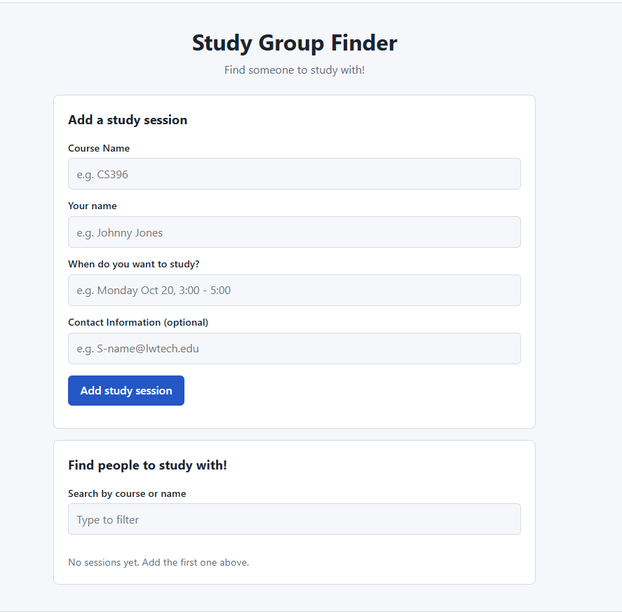

# Study Session Finder

A web app where students post their course availability so classmates can find each other to study with.



## Quickstart

Requires [Node.js](https://nodejs.org) 18 or newer.

```bash
git clone <repo-url> && cd Study-Session-Finder
npm install
node seed.js && node server.js
```

Open <http://localhost:3000>. The database is created automatically, and `seed.js` adds sample sessions.

## How it works

```
Browser (public/)  <-- JSON over fetch -->  Express server (server.js)  <-->  SQLite (study.db)
```

The browser page loads study sessions from the Express API, filters them as you type, and posts new ones from a form. Express saves them in SQLite, so they persist after a restart. Adding a session requires an account: passwords are hashed with bcrypt and login is kept in a session cookie.

## Known limitations

- Availability is free text, so the app can't match times automatically.
- Posts can't be edited or deleted once submitted.
- Sessions aren't linked to accounts, so a logged-in user can post under any name.
- Login sessions are stored in memory, so restarting the server logs everyone out.

## Authors

- Dannika Covarrubias, [GitHub](https://github.com/dannika06)
- Joel Echeverri, [GitHub](https://github.com/Icarus-25)